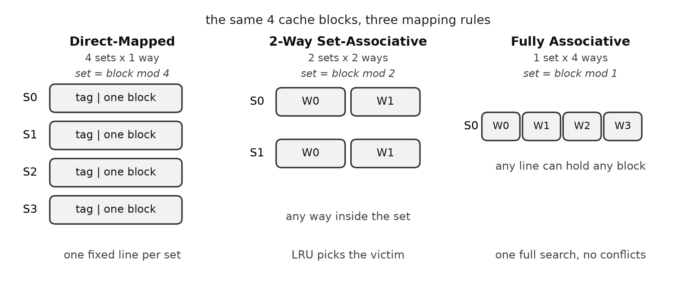
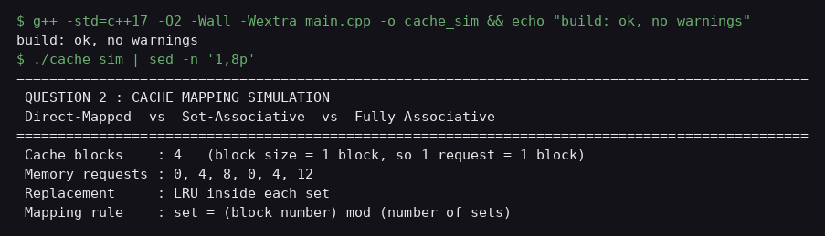
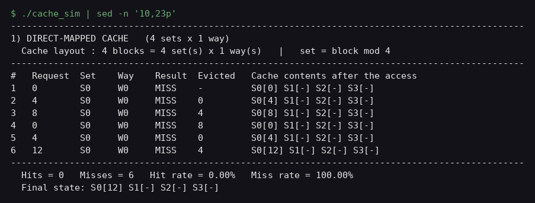
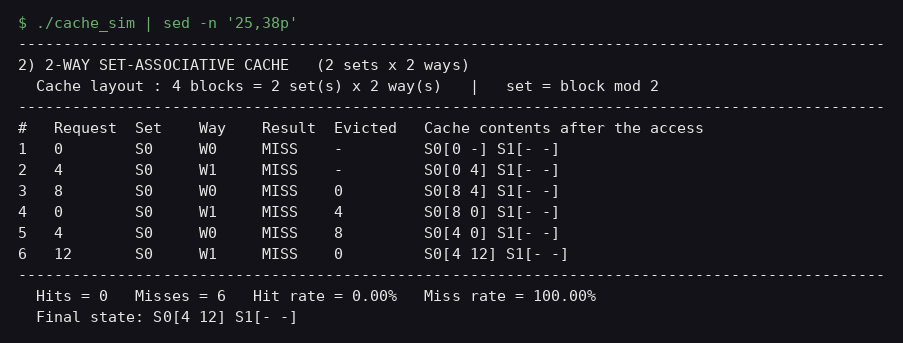
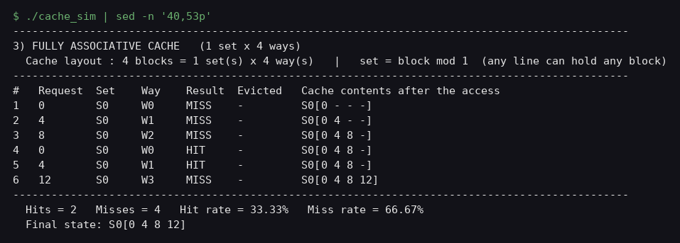
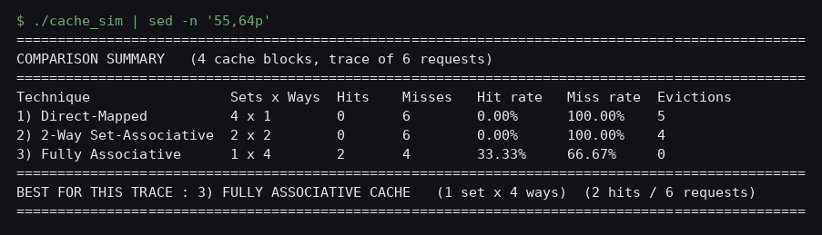
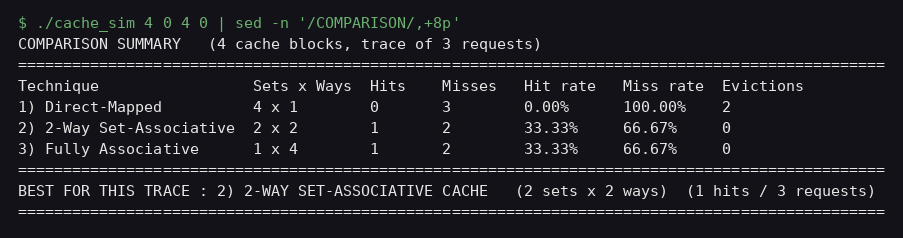

<div style="text-align: center;"></div>

<hr>

<div style="text-align: center;">
<h1>K.R. Mangalam University</h1>
<h3>School of Engineering and Technology</h3>
<h3>COMPUTER ORGANIZATION AND ARCHITECTURE SIMULATION REPORT</h3>
<p>Program: BCA (AI &amp; DS)<br>Course Code - ENCA302 (2025-2026)</p>
</div>

<table class="front">
<tr>
<td><strong>Submitted by:</strong><br>Name: Aditya Shibu<br>Roll Number: 2401201047<br>Course: BCA (AI &amp; DS) - Section B</td>
<td style="text-align: right;"><strong>Submitted To:</strong><br>Alina Banerjee<br>Course Coordinator</td>
</tr>
</table>

<p style="text-align: center;"><strong>GitHub repository:</strong> <a href="https://github.com/Vic-41148/COMPUTER-ORGANIZATION-AND-ARCHITECTURE">github.com/Vic-41148/COMPUTER-ORGANIZATION-AND-ARCHITECTURE</a></p>

<div style="page-break-before: always;"></div>


<style>pre { font-size: 10px; } table { font-size: 12.5px; break-inside: avoid; } th, td { padding: 4px 8px; } table.front, table.front td { border: none; }</style>

## 1. Question

Develop a simulation that compares the mapping of memory blocks using
**Direct-Mapped**, **Set-Associative** and **Fully Associative** mapping. Use a
small cache and a given sequence of memory block requests. For each mapping
technique, display the cache location selected for each memory block, the cache
hit or miss, the number of cache hits and the number of cache misses. Compare
the results and briefly explain which mapping technique gives better
flexibility for the given access sequence.

Example: cache blocks = 4, memory requests = 0, 4, 8, 0, 4, 12.

The simulation is written in C++17. It runs the same trace through all three
mappings and prints one row for each request.

## 2. Cache Design

Figure 1 shows the same 4-block cache built three ways. The set count and the
way count trade off, so sets x ways is 4 in every case.



Figure 1. All three caches hold 4 blocks. Sets and ways trade off; sets x ways = 4.


### 2.1 Cache model

The cache holds 4 blocks. The block size is one block, so each memory request
is a block number and the offset field is empty. All three techniques use one
engine. The engine takes `(blocks, ways)` and derives the set count:

```text
sets = blocks / ways
direct-mapped      -> ways = 1
set-associative    -> 1 < ways < blocks
fully associative  -> ways = blocks
```

| Technique | Sets | Ways | Lines | Index bits | Set rule |
|---|---|---|---|---|---|
| Direct-Mapped | 4 | 1 | 4 | 2 | `block mod 4` |
| 2-Way Set-Associative | 2 | 2 | 4 | 1 | `block mod 2` |
| Fully Associative | 1 | 4 | 4 | 0 | `block mod 1` (any line) |

### 2.2 Address split

A request is a memory block number. The index selects the set. The remaining
high bits form the tag. In the fully associative cache there is no index, so
the full block number is the tag.

| Block | Binary | Direct tag | Direct index | 2-way tag | 2-way index | FA tag |
|---|---|---|---|---|---|---|
| 0 | 0000 | 00 | 00 | 000 | 0 | 0000 |
| 4 | 0100 | 01 | 00 | 010 | 0 | 0100 |
| 8 | 1000 | 10 | 00 | 100 | 0 | 1000 |
| 12 | 1100 | 11 | 00 | 110 | 0 | 1100 |

The index column is the important one. Every block in the trace has index
`00` in the 4-set cache and index `0` in the 2-set cache.


### 2.3 Set selected for each request

| Request | Direct set | 2-way set | FA set |
|---|---|---|---|
| 0 | S0 | S0 | S0 |
| 4 | S0 | S0 | S0 |
| 8 | S0 | S0 | S0 |
| 12 | S0 | S0 | S0 |

All four distinct blocks map to set 0 in both the direct-mapped cache and the
2-way cache. The trace is a worst case for any cache with fixed sets.

### 2.4 Replacement policy

Each line holds a valid bit, the block number and a `lastUsed` counter. A hit
refreshes the counter. A miss takes an invalid line first. If the set is full,
the miss evicts the line with the smallest counter. This is least recently used
(LRU).

The direct-mapped cache has one way, so it never chooses a victim. LRU acts
only in the 2-way and fully associative caches.


### 2.5 Worked example: block 12

Block 12 is `1100` in binary. The last request of the trace shows the three
searches side by side.

| Cache | Set | Tag | Lines compared | Outcome |
|---|---|---|---|---|
| Direct-Mapped | S0 | `11` | 1 | tag `11` is not in S0, miss, block 4 evicted |
| 2-Way | S0 | `110` | 2 | tag `110` is not in W0 or W1, miss, LRU evicts block 0 |
| Fully Associative | S0 | `1100` | 4 | tag `1100` is absent, free line W3, miss with no eviction |

A direct-mapped cache compares one tag. A 2-way cache compares two tags and
then picks a way. A fully associative cache compares every tag in the cache.
The same request costs more hardware at each step, and this trace returns two
extra hits for that cost.


<div style="page-break-before: always;"></div>

## 3. Simulation Results

### 3.1 Direct-mapped cache

| # | Block | Set | Way | Result | Evicted | Cache after the access |
|---|---|---|---|---|---|---|
| 1 | 0 | S0 | W0 | MISS | - | S0[0] S1[-] S2[-] S3[-] |
| 2 | 4 | S0 | W0 | MISS | 0 | S0[4] S1[-] S2[-] S3[-] |
| 3 | 8 | S0 | W0 | MISS | 4 | S0[8] S1[-] S2[-] S3[-] |
| 4 | 0 | S0 | W0 | MISS | 8 | S0[0] S1[-] S2[-] S3[-] |
| 5 | 4 | S0 | W0 | MISS | 0 | S0[4] S1[-] S2[-] S3[-] |
| 6 | 12 | S0 | W0 | MISS | 4 | S0[12] S1[-] S2[-] S3[-] |

Result: 0 hits, 6 misses, 5 evictions. Hit rate 0.00%, miss rate 100.00%.

Every request misses. The single line of set 0 holds one block, and the next
request throws it out. The repeats of 0 and 4 find a different block in the
line, so they miss too.

### 3.2 2-way set-associative cache

| # | Block | Set | Way | Result | Evicted | Cache after the access |
|---|---|---|---|---|---|---|
| 1 | 0 | S0 | W0 | MISS | - | S0[0 -] S1[- -] |
| 2 | 4 | S0 | W1 | MISS | - | S0[0 4] S1[- -] |
| 3 | 8 | S0 | W0 | MISS | 0 | S0[8 4] S1[- -] |
| 4 | 0 | S0 | W1 | MISS | 4 | S0[8 0] S1[- -] |
| 5 | 4 | S0 | W0 | MISS | 8 | S0[4 0] S1[- -] |
| 6 | 12 | S0 | W1 | MISS | 0 | S0[4 12] S1[- -] |

Result: 0 hits, 6 misses, 4 evictions. Hit rate 0.00%, miss rate 100.00%.

Two lines are better than one, but three blocks compete for them at request 3.
Blocks 0 and 4 are both needed again, so one of them must go. The same fight
repeats at every request.

### 3.3 Fully associative cache

| # | Block | Set | Way | Result | Evicted | Cache after the access |
|---|---|---|---|---|---|---|
| 1 | 0 | S0 | W0 | MISS | - | S0[0 - - -] |
| 2 | 4 | S0 | W1 | MISS | - | S0[0 4 - -] |
| 3 | 8 | S0 | W2 | MISS | - | S0[0 4 8 -] |
| 4 | 0 | S0 | W0 | HIT | - | S0[0 4 8 -] |
| 5 | 4 | S0 | W1 | HIT | - | S0[0 4 8 -] |
| 6 | 12 | S0 | W3 | MISS | - | S0[0 4 8 12] |

Result: 2 hits, 4 misses, 0 evictions. Hit rate 33.33%, miss rate 66.67%.

Block 12 arrives after the two hits, so it finds free line W3. No line is
evicted.


### 3.4 Comparison

| Technique | Sets x Ways | Hits | Misses | Hit rate | Miss rate | Evictions |
|---|---|---|---|---|---|---|
| Direct-Mapped | 4 x 1 | 0 | 6 | 0.00% | 100.00% | 5 |
| 2-Way Set-Associative | 2 x 2 | 0 | 6 | 0.00% | 100.00% | 4 |
| Fully Associative | 1 x 4 | 2 | 4 | 33.33% | 66.67% | 0 |

The fully associative cache gives the best result: 2 hits against 0 for the
other two. It also has the lowest miss rate and no evictions. Direct-mapped is
the most rigid and evicts on five of six requests.


## 4. Analysis

### 4.1 Miss classification

| Technique | Compulsory | Conflict | Total misses | Hits |
|---|---|---|---|---|
| Direct-Mapped | 4 | 2 | 6 | 0 |
| 2-Way Set-Associative | 4 | 2 | 6 | 0 |
| Fully Associative | 4 | 0 | 4 | 2 |

The trace touches four distinct blocks, so four compulsory misses are the
minimum for any cache. The fully associative cache stops there. The other two
add two conflict misses, on the repeats of 0 and 4. The mapping forces those
blocks into one small set, so the cache cannot keep them all.


### 4.2 Flexibility

Flexibility is the freedom to place a block. The three techniques differ
exactly in that freedom:

- Fully associative: any block goes into any of 4 lines, so placement never
  fails while a line is free.
- 2-way: a block goes into either way of one fixed set.
- Direct-mapped: a block goes into one fixed line, with no choice.

More freedom tends to remove conflict misses, so the hit rate tends to rise.
This trace is not a general rule. A cyclic loop larger than the cache can give
0 hits under LRU even in a fully associative cache, while a direct-mapped
cache keeps the blocks that hit its own sets. The cost is hardware. A direct-mapped cache compares one tag per access. A 2-way cache
compares two tags and needs a 2:1 multiplexer. A fully associative cache
compares all four tags and needs a 4:1 multiplexer. Real processors use full
associativity only for small structures such as the TLB, and use
set-associative caches for L1 and L2.


### 4.3 Average memory access time

The standard formula is:

```text
AMAT = hit time + miss rate x miss penalty
```

Assume a hit time of 1 cycle and a miss penalty of 50 cycles. The values are
illustrative and not measured.

| Technique | Hit rate | Miss rate | AMAT (cycles) |
|---|---|---|---|
| Direct-Mapped | 0.00% | 100.00% | 1 + 1.0000 x 50 = 51.00 |
| 2-Way Set-Associative | 0.00% | 100.00% | 1 + 1.0000 x 50 = 51.00 |
| Fully Associative | 33.33% | 66.67% | 1 + 0.6667 x 50 = 34.33 |

Under these assumptions the fully associative cache is about 1.5 times faster
on this trace. The result depends on the trace, not on the cache size. All
three caches hold the same 4 blocks.


<div style="page-break-before: always;"></div>

## 5. Execution - Real Linux Terminal

Implementation: `main.cpp` (362 lines, sha256
`0083c9a1f05e11e459052ca036d5ad18441f12471c8878afa24dc7485dfa856c`), compiled
and run on 17 Nov 2026 with g++ 16.2.1 on Linux 7.3.4-arch1-2. The full log is
in `docs/terminal_log.txt`.

Run command:

```bash
./cache_sim
```


### 5.1 Build and default run




### 5.2 Per-technique traces

Direct-mapped: every request evicts the previous block from set 0.



2-way set-associative: the two ways of set 0 still cannot hold three blocks.



Fully associative: the repeats of 0 and 4 hit, and block 12 takes the free
line.



### 5.3 Comparison and best mapping



### 5.4 Extra verification runs

Each run below is a fresh process with the same code. The expected hits come
from hand analysis of the trace.

| Command | Cache | Trace | Direct hits | Assoc. hits | FA hits |
|---|---|---|---|---|---|
| `./cache_sim` | 4 blocks | 0 4 8 0 4 12 | 0 | 0 (2-way) | 2 |
| `./cache_sim 4 0 4 0` | 4 blocks | 0 4 0 | 0 | 1 (2-way) | 1 |
| `./cache_sim 8 0 1 2 3 0 1 2 3` | 8 blocks | 0 1 2 3 0 1 2 3 | 4 | 4 (2-way) | 4 |
| `./cache_sim 8 -a 4 0 1 0 1` | 8 blocks | 0 1 0 1 | 2 | 2 (4-way) | 2 |

The second run shows the case that the question's trace hides: when two blocks
share a set and the set has two ways, the 2-way cache keeps both and hits.
Extra associativity does not help when every block maps to its own set, as the
third and fourth runs show.



<div style="page-break-before: always;"></div>

## 6. Full code listing (main.cpp, 362 lines)

The file has four parts: `Line` and `Cache` (the engine), `simulate()` (one
technique and its table), `report()` (the comparison and the verdict), and
`main()` (argument parsing). All three techniques call the same `Cache::access`.

```cpp
// =============================================================================
//  Question 2 : Cache Mapping Simulation
//  Compares Direct-Mapped / Set-Associative / Fully Associative mapping.
//
//  Model
//  -----
//  * The cache holds `blocks` cache lines (default 4, as in the question).
//  * Every memory request is a block number, so block size = 1 block.
//  * All three techniques are simulated by the SAME engine:
//        - Direct-Mapped      -> sets = blocks, ways = 1
//        - Set-Associative    -> sets = blocks / ways  (ways >= 2)
//        - Fully Associative  -> sets = 1, ways = blocks
//    The only difference is how many sets exist, which is exactly what the
//    mapping technique decides.  Replacement inside a set uses LRU.
//
//  Mapping rule :  set = (block number) mod (number of sets)
//
//  Build : g++ -std=c++17 -O2 -Wall -Wextra main.cpp -o cache_sim
//  Run   : ./cache_sim                          (question's example)
//          ./cache_sim 8 0 4 8 12 16 20 24      (8 blocks, custom trace)
//          ./cache_sim 8 -a 4 0 1 2 3 4 5 6     (8 blocks, 4-way)
// =============================================================================

#include <algorithm>
#include <iomanip>
#include <iostream>
#include <limits>
#include <sstream>
#include <string>
#include <vector>

// -----------------------------------------------------------------------------
//  One cache line
// -----------------------------------------------------------------------------
struct Line {
    bool      valid    = false;
    long long block    = -1;   // which memory block is stored here
    long long lastUsed = 0;    // counter used by the LRU policy
};

// -----------------------------------------------------------------------------
//  The cache itself (one engine for all three mappings)
// -----------------------------------------------------------------------------
class Cache {
public:
    Cache(int blocks, int ways)
        : ways_(ways), sets_(blocks / ways), grid_(sets_, std::vector<Line>(ways)) {}

    int ways() const { return ways_; }
    int sets() const { return sets_; }
    const std::vector<std::vector<Line>>& grid() const { return grid_; }

    // What happened to one memory request
    struct Outcome {
        bool      hit     = false;
        int       set     = 0;
        int       way     = 0;
        long long evicted = -1;    // block thrown out (-1 = nothing evicted)
    };

    Outcome access(long long block, long long tick) {
        const int set = static_cast<int>(((block % sets_) + sets_) % sets_);
        auto& lines = grid_[set];

        // ---- probe every way of the selected set -------------------------
        for (int w = 0; w < ways_; ++w) {
            if (lines[w].valid && lines[w].block == block) {
                lines[w].lastUsed = tick;          // refresh LRU age
                return {true, set, w, -1};
            }
        }

        // ---- miss: choose a victim ---------------------------------------
        int       way     = -1;
        long long evicted = -1;

        for (int w = 0; w < ways_; ++w) {          // prefer an empty line
            if (!lines[w].valid) { way = w; break; }
        }
        if (way < 0) {                             // set is full -> LRU victim
            way = 0;
            for (int w = 1; w < ways_; ++w)
                if (lines[w].lastUsed < lines[way].lastUsed) way = w;
            evicted = lines[way].block;
        }

        lines[way] = Line{true, block, tick};
        return {false, set, way, evicted};
    }

private:
    int                             ways_;
    int                             sets_;
    std::vector<std::vector<Line>>  grid_;
};

// -----------------------------------------------------------------------------
//  Small formatting helpers
// -----------------------------------------------------------------------------
static std::string formatSet(int index, const std::vector<Line>& s) {
    std::ostringstream os;
    os << "S" << index << "[";
    for (std::size_t i = 0; i < s.size(); ++i) {
        if (i) os << ' ';
        os << (s[i].valid ? std::to_string(s[i].block) : std::string("-"));
    }
    os << "]";
    return os.str();
}

static std::string formatContents(const Cache& c) {
    std::string out;
    for (int i = 0; i < c.sets(); ++i) {
        if (i) out += ' ';
        out += formatSet(i, c.grid()[i]);
    }
    return out;
}

static std::string pct(long long part, long long whole) {
    if (whole <= 0) return "  0.00%";
    std::ostringstream os;
    os << std::fixed << std::setprecision(2)
       << (100.0 * static_cast<double>(part) / static_cast<double>(whole)) << "%";
    return os.str();
}

struct Stats {
    std::string name;
    std::string shortName;
    int         sets = 0;
    int         ways = 0;
    long long   hits = 0;
    long long   misses = 0;
    long long   evictions = 0;
    long long   total() const { return hits + misses; }
};

// -----------------------------------------------------------------------------
//  Run one technique and print its per-request table
// -----------------------------------------------------------------------------
static Stats simulate(const std::string&            title,
                      const std::string&            shortName,
                      const std::string&            formula,
                      int                           blocks,
                      int                           ways,
                      const std::vector<long long>& requests)
{
    Cache cache(blocks, ways);
    Stats st;
    st.name      = title;
    st.shortName = shortName;
    st.sets = cache.sets();
    st.ways = cache.ways();

    std::cout << "\n" << std::string(96, '-') << "\n";
    std::cout << title << "\n";
    std::cout << "  Cache layout : " << blocks << " blocks = "
              << cache.sets() << " set(s) x " << cache.ways() << " way(s)   |   "
              << formula << "\n";
    std::cout << std::string(96, '-') << "\n";
    std::cout << std::left
              << std::setw(4)  << "#"
              << std::setw(9)  << "Request"
              << std::setw(7)  << "Set"
              << std::setw(7)  << "Way"
              << std::setw(8)  << "Result"
              << std::setw(10) << "Evicted"
              << "Cache contents after the access\n";

    long long tick = 1;
    for (std::size_t i = 0; i < requests.size(); ++i) {
        const auto r = cache.access(requests[i], tick++);
        if (r.hit) ++st.hits; else ++st.misses;
        if (r.evicted >= 0) ++st.evictions;

        std::cout << std::left
                  << std::setw(4)  << (i + 1)
                  << std::setw(9)  << requests[i]
                  << std::setw(7)  << ("S" + std::to_string(r.set))
                  << std::setw(7)  << ("W" + std::to_string(r.way))
                  << std::setw(8)  << (r.hit ? "HIT" : "MISS")
                  << std::setw(10) << (r.evicted >= 0 ? std::to_string(r.evicted) : std::string("-"))
                  << formatContents(cache) << "\n";
    }

    std::cout << std::string(96, '-') << "\n";
    std::cout << "  Hits = " << st.hits << "   Misses = " << st.misses
              << "   Hit rate = " << pct(st.hits, st.total())
              << "   Miss rate = " << pct(st.misses, st.total()) << "\n";
    std::cout << "  Final state: " << formatContents(cache) << "\n";
    return st;
}

// -----------------------------------------------------------------------------
//  Comparison table + written conclusion
// -----------------------------------------------------------------------------
static void report(const std::vector<Stats>& all, int blocks) {
    std::cout << "\n" << std::string(96, '=') << "\n";
    std::cout << "COMPARISON SUMMARY   (" << blocks << " cache blocks, trace of "
              << all.front().total() << " requests)\n";
    std::cout << std::string(96, '=') << "\n";
    std::cout << std::left
              << std::setw(26) << "Technique"
              << std::setw(13) << "Sets x Ways"
              << std::setw(8)  << "Hits"
              << std::setw(9)  << "Misses"
              << std::setw(11) << "Hit rate"
              << std::setw(11) << "Miss rate"
              << "Evictions\n";

    for (const auto& s : all) {
        std::ostringstream layout;
        layout << s.sets << " x " << s.ways;
        std::cout << std::left
                  << std::setw(26) << s.shortName
                  << std::setw(13) << layout.str()
                  << std::setw(8)  << s.hits
                  << std::setw(9)  << s.misses
                  << std::setw(11) << pct(s.hits, s.total())
                  << std::setw(11) << pct(s.misses, s.total())
                  << s.evictions << "\n";
    }

    // -------- pick the winner (more hits, then fewer evictions) ------------
    const Stats* best = &all.front();
    for (const auto& s : all) {
        if (s.hits > best->hits ||
            (s.hits == best->hits && s.evictions < best->evictions))
            best = &s;
    }

    std::cout << std::string(96, '=') << "\n";
    std::cout << "BEST FOR THIS TRACE : " << best->name
              << "  (" << best->hits << " hits / " << best->total() << " requests)\n";
    std::cout << std::string(96, '=') << "\n";

    std::cout << R"(
WHY (brief explanation)
-----------------------
* Direct-mapped keeps exactly ONE line per set and the set is fixed by
  (block mod sets).  Two blocks that map to the same set fight for that single
  line, so the later request always throws the earlier one out.  This is a
  CONFLICT MISS: the data may still be needed, but there is nowhere to keep it.

* Full associativity lets a block live in ANY line of the cache, so the only
  misses left are COMPULSORY (first touch) and CAPACITY misses.  It needs the
  most comparators/hardware to search all ways, which is why real CPUs use it
  only for small structures such as TLBs.

* Set-associative mapping is the compromise: a block may go into any way of its
  set, so a couple of colliding blocks can coexist, but the hardware only has to
  compare `ways` tags instead of all `blocks` tags.

In the example trace 0, 4, 8, 0, 4, 12 all blocks are multiples of 4, so every
one of them maps to set 0 in the direct-mapped cache (mod 4) and also to set 0 in
the 2-way cache (mod 2).  All six requests therefore pile onto one set and the
caches thrash: 0 hits.  The fully associative cache spreads those same blocks
over all 4 lines, so the repeats of 0 and 4 are served from the cache: 2 hits.
=> For this access sequence the FULLY ASSOCIATIVE mapping gives the best
   flexibility and the lowest miss rate; direct-mapped is the most rigid.
)";
}

// -----------------------------------------------------------------------------
//  main
// -----------------------------------------------------------------------------
static void usage(const char* exe) {
    std::cout <<
        "Usage: " << exe << " [cacheBlocks] [-a ways] [block block ...]\n\n"
        "  cacheBlocks : number of cache lines (default 4)\n"
        "  -a ways     : associativity for the set-associative run (default 2)\n"
        "  blocks...   : memory block requests (default 0 4 8 0 4 12)\n\n"
        "Examples:\n"
        "  " << exe << "\n"
        "  " << exe << " 8 0 4 8 12 16 20 24\n"
        "  " << exe << " 8 -a 4 0 1 2 3 4 5 6\n";
}

int main(int argc, char** argv) {
    int blocks = 4;
    int assocWays = 2;
    std::vector<long long> requests = {0, 4, 8, 0, 4, 12};

    std::vector<std::string> args(argv + 1, argv + argc);
    if (!args.empty() && (args[0] == "-h" || args[0] == "--help")) {
        usage(argv[0]);
        return 0;
    }

    // ---- parse ------------------------------------------------------------
    std::size_t i = 0;
    if (i < args.size()) {
        try {
            std::size_t used = 0;
            int v = std::stoi(args[i], &used);
            if (used == args[i].size() && v > 0) { blocks = v; ++i; }
        } catch (...) { /* not a number: treat everything as a request */ }
    }
    if (i + 1 < args.size() && args[i] == "-a") {
        try { assocWays = std::max(2, std::stoi(args[i + 1])); i += 2; }
        catch (...) { std::cerr << "Bad -a value\n"; return 1; }
    }
    if (i < args.size()) {
        requests.clear();
        for (; i < args.size(); ++i) {
            try { requests.push_back(std::stoll(args[i])); }
            catch (...) {
                std::cerr << "Error: '" << args[i] << "' is not a memory block number.\n";
                return 1;
            }
        }
    }
    if (requests.empty()) {
        std::cerr << "Error: need at least one memory block request.\n";
        return 1;
    }

    // The set-associative count must split the cache into equal sets, so fall
    // back to the largest associativity that divides the number of blocks.
    if (assocWays >= blocks) assocWays = std::max(1, blocks / 2);
    while (assocWays > 1 && blocks % assocWays != 0) --assocWays;
    const bool assocDegraded = (assocWays < 2);
    if (assocDegraded) assocWays = 1;

    // ---- banner -----------------------------------------------------------
    std::cout << std::string(96, '=') << "\n";
    std::cout << " QUESTION 2 : CACHE MAPPING SIMULATION\n";
    std::cout << " Direct-Mapped  vs  Set-Associative  vs  Fully Associative\n";
    std::cout << std::string(96, '=') << "\n";
    std::cout << " Cache blocks    : " << blocks << "   (block size = 1 block, so 1 request = 1 block)\n";
    std::cout << " Memory requests : ";
    for (std::size_t k = 0; k < requests.size(); ++k)
        std::cout << (k ? ", " : "") << requests[k];
    std::cout << "\n";
    std::cout << " Replacement     : LRU inside each set\n";
    std::cout << " Mapping rule    : set = (block number) mod (number of sets)\n";
    if (assocDegraded)
        std::cout << " [note] " << blocks << " blocks cannot be split into 2 or more equal"
                     " sets, so the set-associative run uses 1 way.\n";

    // ---- the three techniques --------------------------------------------
    Stats dm = simulate("1) DIRECT-MAPPED CACHE   (" + std::to_string(blocks) + " sets x 1 way)",
                        "1) Direct-Mapped",
                        "set = block mod " + std::to_string(blocks),
                        blocks, 1, requests);

    Stats sa = simulate("2) " + std::to_string(assocWays) + "-WAY SET-ASSOCIATIVE CACHE   ("
                            + std::to_string(blocks / assocWays) + " sets x "
                            + std::to_string(assocWays) + " ways)",
                        "2) " + std::to_string(assocWays) + "-Way Set-Associative",
                        "set = block mod " + std::to_string(blocks / assocWays),
                        blocks, assocWays, requests);

    Stats fa = simulate("3) FULLY ASSOCIATIVE CACHE   (1 set x " + std::to_string(blocks) + " ways)",
                        "3) Fully Associative",
                        "set = block mod 1  (any line can hold any block)",
                        blocks, blocks, requests);

    report({dm, sa, fa}, blocks);
    return 0;
}
```

## 7. Explanation

The program models the cache part of the memory hierarchy. A request leaves
the processor as a block number. The index bits select a set, and the tag
decides hit or miss. The same request sequence goes through three caches of
equal size, so any difference in the result comes from the mapping.

The trace is built from blocks 0, 4, 8 and 12. All of them are multiples of 4,
so their low index bits are zero. In the direct-mapped cache and the 2-way
cache they all land in set 0. Four blocks compete for one line, then for two
lines. Both caches thrash and show 0 hits. This is a conflict miss, not a
capacity miss: the direct-mapped cache has free lines in sets 1 to 3, and the
2-way cache has a free set 1, but the mapping does not let the blocks use
them.

The fully associative cache has one set with four ways. The four blocks fit
together, so the repeats of 0 and 4 are temporal-locality hits. Only the first
touch of each block misses. The result shows both effects at once: mapping
decides how well a cache uses its own capacity, and locality decides which
repeats can become hits.

The simulation also shows the hardware trade-off. Full associativity wins on
hits but needs a comparator for every line. Direct-mapped is the cheapest and
the most prone to conflict misses. The 2-way cache sits between the two, which
is why it is the common choice in real processors.

The model has limits. It uses a block size of one block, one trace, and no
write policy, so it measures conflict behaviour only. A larger trace would add
capacity misses. A write-back policy would add dirty bits and write-back
traffic. This simulation shows neither.

## 8. Marking-scheme mapping (5 marks)

| Component | Marks | Where shown |
|---|---|---|
| Correct Simulation Implementation | 2 | Code Sec.6, trace reproduced Sec.3, extra runs Sec.5.4 |
| Application of Memory/Cache Concept | 1 | Mapping rules, address split, LRU Sec.2, Figure 1 |
| Correct Calculation or Performance Analysis | 1 | Hit and miss counts, rates, miss classes and AMAT Sec.3-4 |
| Working Output and Explanation | 1 | Terminal captures Sec.5 and the explanation in Sec.7 |
| Total | 5 | |

## 9. How to reproduce

The report, the source and the captures live in the GitHub repository:

```bash
git clone https://github.com/Vic-41148/COMPUTER-ORGANIZATION-AND-ARCHITECTURE.git
cd COMPUTER-ORGANIZATION-AND-ARCHITECTURE
g++ -std=c++17 -O2 -Wall -Wextra main.cpp -o cache_sim
./cache_sim
sha256sum main.cpp   # must match the hash in Sec. 5
```

The extra traces from Section 5.4 use the same binary. `./cache_sim --help`
prints the argument format.
